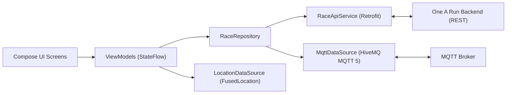

# One A Run

**Real-time, head-to-head competitive running on Android.**  
Create a race session, share a 6-character join code, and race an opponent live with GPS telemetry, MQTT 5 streaming, and post-race route visualization on Google Maps.


-3C5280)

---

## Overview

**One A Run** turns short-distance sprints and runs (100m–1,000m) into live 1v1 races. Both runners connect to a shared session via a REST backend and exchange real-time location, pace, and race status updates over MQTT 5—with HTTP polling fallback for resilience on mobile networks.

### Race Flow

1. **Home** — Grants runtime location permissions and lets the user choose to host or join a race.
2. **Create / Join Race** — The host sets a runner name and target distance (`100m` to `1,000m`) to generate a 6-character join code; the guest enters their name and code to join.
3. **Waiting Room & Lobby** — Monitors opponent arrival via MQTT (`race/{sessionId}/status`) combined with background REST polling.
4. **Countdown** — Synchronized `3 - 2 - 1 - Go!` pre-race countdown.
5. **Live Race** — Streams filtered GPS updates, calculates sliding-window pace (`M:SS/km`), tracks elapsed time, displays live 1st/2nd place ranking, and keeps the screen awake (`FLAG_KEEP_SCREEN_ON`).
6. **Finish & Route Map** — Shows win/loss outcome, total distance, elapsed duration, best pace, and an interactive Google Maps polyline of the recorded GPS trajectory with start/finish markers.

---

## Key Features

- **Precision GPS Telemetry & Noise Filtering**
  - Powered by Google Play Services `FusedLocationProviderClient` (`PRIORITY_HIGH_ACCURACY`, 1.5s interval / 1s min interval).
  - Multi-stage fix filtering in [`LocationDataSource`](app/src/main/java/com/shiwa/onearun/data/location/LocationDataSource.kt):
    - Rejects stale cached fixes (`> 5s` old)
    - Discards low-accuracy fixes (`accuracy > 20m` or missing accuracy)
    - Enforces a dynamic displacement gate (`max(3m, accuracy)`)
    - Filters stationary speed noise (`< 0.8 m/s`)
- **Low-Latency Real-Time Sync**
  - **MQTT 5** via HiveMQ client with automatic reconnect (1s–15s backoff) and automatic TLS selection (TLS enabled on non-`1883` ports such as `8883` to avoid CGNAT drops on 4G/5G; plaintext TCP on `1883`).
  - **QoS 0** for high-frequency location updates (`race/{sessionId}/runner/{runnerId}/location`) and **QoS 1** for progress and status events.
  - **Dual-mode fallback** pairing MQTT streams with Retrofit REST polling.
- **Interactive Post-Race Analytics**
  - Google Maps Compose (`GoogleMap`, `Polyline`, `Marker`) rendering the runner's route alongside final race metrics.

---

## Architecture

The app follows **MVVM** with unidirectional state flows (`StateFlow` / `SharedFlow`), a single-activity **Jetpack Compose Navigation** host, and manual dependency injection via [`AppContainer`](app/src/main/java/com/shiwa/onearun/data/container/AppContainer.kt).



### Project Structure

```text
app/src/main/java/com/shiwa/onearun/
├── OneARunApplication.kt               # Application entry point & AppContainer initialization
├── MainActivity.kt                     # Single-activity host for Compose Navigation
├── home/                               # Home screen & runtime location permission handling
├── createrace/                         # Host race creation form (name & 100m–1000m distance)
├── createracewaiting/                  # Host waiting room with shareable 6-char join code
├── joinrace/                           # Guest join form (name & session code)
├── lobby/                              # Pre-race lobby screen
├── countdown/                          # 3-2-1 countdown screen
├── race/                               # Live race UI & telemetry/ranking engine
├── finish/                             # Post-race summary & Google Maps route polyline
├── navigation/                         # Navigation destinations, args, and NavGraph
├── data/
│   ├── container/AppContainer.kt       # Manual DI container
│   ├── location/LocationDataSource.kt  # GPS provider wrapper & noise filter
│   ├── remote/
│   │   ├── MqttDataSource.kt           # HiveMQ MQTT 5 client (TLS, auto-reconnect, pub/sub)
│   │   └── api/                        # Retrofit service & DTOs (/api/v1/race, /join)
│   └── repository/RaceRepository.kt    # Unified data source for REST + MQTT
└── ui/theme/                           # Material 3 color palette, typography, and theme
```

---

## Tech Stack

| Layer | Technology |
| --- | --- |
| **Language & JVM** | Kotlin `2.4.20`, Java 11 bytecode target (JDK 21 toolchain) |
| **Android SDK** | Min SDK `24`, Compile & Target SDK `37` |
| **UI & Navigation** | Jetpack Compose (BOM `2026.09.00`), Material 3 `1.4.0`, Navigation Compose `2.10.2` |
| **Architecture** | MVVM, Kotlin Coroutines, `StateFlow` / `SharedFlow`, Manual DI |
| **REST Networking** | Retrofit `2.11.0` + Gson Converter |
| **Real-Time Messaging** | HiveMQ MQTT Client `1.4.0` (MQTT 5) |
| **Location & Maps** | Play Services Location `21.4.0`, Play Services Maps `19.1.0`, Maps Compose `6.5.0` |
| **Testing** | JUnit 4, MockK `1.13.12`, `kotlinx-coroutines-test` `1.8.1`, Espresso, Compose UI Test |
| **Build** | AGP `9.2.1`, Gradle `9.4.1`, R8 minification & resource shrinking (release) |

---

## Getting Started

### Prerequisites

- **Android Studio** (with Android SDK 37 installed)
- **JDK 21**
- Running instance of the **[One A Run Backend](https://github.com/luisfelipegraciolli/One-a-Run-Backend)** and an **MQTT Broker** (e.g., EMQX or HiveMQ)
- A **Google Maps API Key** (for the post-race map on the Finish screen)
- An Android device or emulator with Location Services enabled

### Configuration

Copy [`local.properties.example`](local.properties.example) to `local.properties` in the project root (or provide the same keys as environment variables):

```bash
cp local.properties.example local.properties
```

Edit `local.properties`:

```properties
# Backend REST API base URL
BASE_URL=http://10.0.2.2:8080/

# MQTT broker host and port (port 1883 = plaintext TCP; other ports such as 8883 = TLS)
MQTT_HOST=broker.emqx.io
MQTT_PORT=1883

# Google Maps API key (injected into AndroidManifest.xml)
MAPS_API_KEY=YOUR_GOOGLE_MAPS_API_KEY_HERE
```

> [!TIP]
> Use `http://10.0.2.2:<port>/` when testing against a backend running on your host machine from the Android Emulator. For physical devices on the same network, use your machine's LAN IP address.  
> If `MQTT_HOST` is omitted, [`app/build.gradle.kts`](app/build.gradle.kts) falls back to the host parsed from `BASE_URL` (or `broker.emqx.io`), and `MQTT_PORT` defaults to `1883`.

---

## Building & Testing

```bash
# Build debug APK
./gradlew assembleDebug

# Install & launch on a connected device or emulator
./gradlew installDebug

# Build minified release APK
./gradlew assembleRelease

# Run local unit tests (ViewModels, Repository, serialization)
./gradlew testDebugUnitTest

# Run instrumented tests on a connected device/emulator
./gradlew connectedDebugAndroidTest
```

---

## Related & Maintainer

- **Maintainer:** [Luis Graciolli](https://github.com/luisfelipegraciolli)
- **Backend Repository:** [One-a-Run-Backend](https://github.com/luisfelipegraciolli/One-a-Run-Backend)
